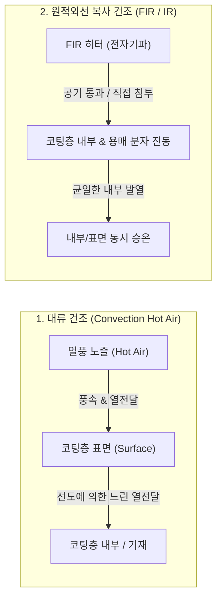
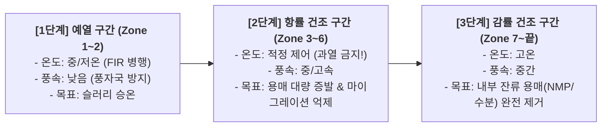

# [제1강] 전극 코터(Coater) 오븐 구조 및 건조 메커니즘 완벽 해부

> **강사 한마디:**  
> "코팅에서 슬러리를 기재(집전체) 위에 예쁘게 올리는 것이 전반전이라면, **오븐(Dryer)에서 용매를 날려 접착력과 기공 구조를 완성하는 것은 후반전이자 승부처**입니다. 건조를 잘못하면 아무리 좋은 슬러리와 다이(Slot Die)를 써도 바인더가 다 떠오르고(Migration) 전극이 갈라져서(Crack) 불량 덩어리가 됩니다. 현장 엔지니어가 반드시 알아야 할 오븐의 구조와 열전달(FIR vs 대류)의 핵심을 짚어드립니다."

---

## 1. 전극 코팅에서 '건조(Drying)'가 왜 그렇게 중요한가?

코팅 직후의 Wet 코팅층은 **활물질 + 도전재 + 바인더 + 용매(양극: NMP, 음극: Water)**가 섞여 있는 진흙 상태입니다. 오븐의 역할은 단순히 액체(용매)를 말리는 것이 아니라, **전극의 미세구조(Micro-structure)를 고정(Fixing)**하는 것입니다.

### ⚠️ 치명적 불량: 바인더 마이그레이션 (Binder Migration)
* **현상:** 건조 속도가 너무 빠르면 표면의 용매가 급격히 증발하면서, 아래쪽의 용매가 모세관 현상(Capillary Force)을 타고 표면으로 강하게 끌려 올라옵니다. 이때 용매에 녹아있던 **바인더(PVDF, SBR)와 가벼운 도전재까지 함께 표면으로 휩쓸려 올라가는 현상**입니다.
* **결과:** 
  1. **접착력(Adhesion) 급락:** 정작 집전체(Al/Cu박)와 활물질이 붙어야 할 바닥면(계면)에 바인더가 고갈되어, 후공정(롤프레스, 슬리팅)에서 전극이 우수수 떨어져 나가는 **박리(Delamination)** 발생.
  2. **저항 증가:** 표면에 절연체인 바인더가 과도하게 몰려 리튬이온의 길을 막음.

---

## 2. 열전달 방식의 이해: 대류(Convection) vs 복사(FIR/IR)

오븐에서 Wet 슬러리에 열을 가해 용매를 증발시키는 방법은 크게 **열풍 대류**와 **적외선 복사(FIR/IR)** 두 가지가 있으며, 현대 최신 코터는 이 둘을 조합한 **하이브리드(Hybrid) 구조**를 사용합니다.

### ① 대류 건조 (Convection Drying - 열풍 방식)
뜨거운 공기(Hot Air)를 노즐을 통해 고속으로 불어넣어 코팅면에 부딪히게 하는 가장 전통적이고 주력인 방식입니다.
* **원리:** 열풍이 코팅층 표면의 경계층(Boundary Layer)을 깨뜨리며 열을 전달(**열전달**)하고, 증발된 용매 증기를 밖으로 쓸어내어(**물질전달**) 증발을 촉진합니다.
* **장점:** 온도 제어가 정밀하고, 증발된 용매(NMP/수분)를 배기(Exhaust)하기에 필수적입니다.
* **단점 (한계):** 열이 **표면에서 내부로** 전달됩니다. 풍속이나 온도를 무리하게 높이면 표면만 먼저 말라 딱딱한 막을 형성하는 **표면 피막(Skinning)** 현상이 생기고, 내부 용매가 갇혔다가 터져 나오는 **핀홀(Pinhole)**이나 심한 **바인더 마이그레이션**을 유발합니다.

### ② FIR / IR 건조 (Far-Infrared Radiation - 원적외선 복사 방식)
공기를 데우지 않고, 전자기파(적외선 파장)를 직접 쏘아 코팅층을 가열하는 방식입니다.
* **원리:** 물(H₂O)이나 NMP 같은 용매 분자는 특정 원적외선(FIR, 파장 약 $3 \sim 100\mu m$) 파장 대역의 에너지를 흡수하면 **분자 자체가 격렬하게 공명 진동**하며 스스로 열을 냅니다.
* **왜 일반 IR(근적외선 NIR)이 아니라 FIR(원적외선)인가?**
  * 근적외선(NIR)은 에너지가 강하지만 반사율이 높은 금속 기재(Al/Cu)나 검은색 활물질 표면만 급격히 과열시킬 위험이 큽니다.
  * 반면 **FIR(원적외선)**은 **용매(물, NMP)와 고분자 바인더의 고유 흡수 파장대와 정확히 일치**하여, 코팅층 내부 깊숙이 침투해 **내부에서부터 균일하게(Volumetric Heating)** 온도를 올립니다.
* **핵심 역할 (Boosting & Leveling):**
  * **오븐 초입(Pre-heating / Zone 1 전후)**에 주로 설치합니다.
  * 코팅 직후 차가운 슬러리의 온도를 내부부터 순식간에 증발 온도(잠열 구간)까지 끌어올려 줍니다 (**승온 구간 단축 = 오븐 전체 길이 단축 및 생산 속도 향상**).
  * 바람(풍압)이 없으므로, 아직 묽은 상태의 코팅액이 바람에 밀려 자국이 남는 **풍자국(Air mark / Mottle)**을 방지하면서 초기 형태를 잡아줍니다.
* **주의점:** 코팅이 멈추었을 때(Line Stop) FIR이 계속 켜져 있으면 기재가 순식간에 타버리거나 끊어지므로(Web Break), 라인 정지 시 즉각 차단/셔터 닫힘 인터록(Interlock)이 필수입니다.

---

## 3. 오븐 하드웨어(기구) 구조: 롤 서포트 vs 플로팅

양면 코팅(Tandem Coater)과 고속 코팅 시대가 되면서 오븐 내부에서 기재(Web)를 어떻게 이송하느냐가 매우 중요해졌습니다.

| 구분 | 롤 서포트 방식 (Roll Support / Arch형) | 에어 플로팅 방식 (Air Floating) |
| :--- | :--- | :--- |
| **구조 개념** | 하부에 가이드 롤(Guide Roll)들이 배치되어 기재를 받쳐주며 이송 (상부에서만 노즐 분사) | 상/하부에서 동시에 에어를 분사하여 **기재를 허공에 띄운 상태(비접촉)**로 이송 |
| **장점** | 장력(Tension) 및 주행 안정성이 높음 | 1. 상/하 동시 열풍으로 **건조 효율 극대화** 2. 롤 접촉에 의한 스크래치나 이물 전사 없음 |
| **단점** | 롤 오염 시 기재 뒷면 찍힘 발생, 단면 열풍으로 건조 효율이 상대적으로 낮음 | 상/하 풍압 밸런스가 깨지면 기재가 출렁거리며 노즐에 닿는 **노즐 스크래치(Touch)** 및 **주름(Wrinkle)** 발생 |
| **현장 포인트** | 롤 정렬(Alignment) 및 베어링 고착 관리 | **상/하 노즐 풍속(차압) 밸런스** 및 웹 장력(Tension) 매칭이 생명이자 노하우 |

---

## 4. 건조 3단계와 오븐 Zone별 온도/풍속 프로파일링 (핵심 실무)

길이가 30m~60m에 달하는 코터 오븐은 보통 **8개~12개 이상의 독립된 Zone**으로 나뉘어 있습니다. 왜 통짜로 안 만들고 쪼개놓았을까요? **건조 구간마다 슬러리의 상태가 완전히 다르기 때문**입니다.

### ① 1단계: 예열 구간 (Pre-heating Period / 초반 Zone)
* **상태:** 코팅 직후라 점도가 낮고 유동성이 큽니다.
* **세팅 전략:** 풍속을 세게 불면 슬러리가 밀려서 물결무늬 불량이 납니다. 따라서 **풍속은 낮추고**, **FIR**이나 적당한 온도로 슬러리 온도를 용매 증발 온도까지 부드럽게 올립니다.

### ② 2단계: 항률 건조 구간 (Constant-Rate Drying Period / 중반 Zone) ⭐가장 중요!
* **상태:** 코팅 표면에 얇은 용매 막이 유지되면서 **전체 용매의 70~80%가 일정한 속도로 가장 활발하게 증발**하는 구간입니다. 이때 입자들이 서로 가까워지며 **전극의 골격(네트워크)이 확정**됩니다.
* **세팅 전략:** **바인더 마이그레이션이 결정되는 마의 구간**입니다! 욕심내서 온도와 풍속을 너무 높이면 바인더가 표면으로 다 올라옵니다. 접착력 확보를 위해 증발 속도가 임계치를 넘지 않도록 온도를 세심하게 눌러주어야 합니다.

### ③ 3단계: 감률 건조 구간 (Falling-Rate Drying Period / 후반 Zone)
* **상태:** 이미 전극 입자들의 뼈대는 다 굳었고(고형화 완료), 이제 입자 사이 미세한 기공(Pore) 깊숙이 숨어있는 **잔류 용매(Residual NMP / 수분)**가 표면으로 확산되어 나오는 구간입니다.
* **세팅 전략:** 이미 바인더 위치는 고정되었으므로 마이그레이션 걱정이 적습니다. 따라서 **온도를 높게 설정**하여 기공 깊숙한 곳의 잔류 용매를 끝까지 뽑아내야 합니다. (잔류 NMP가 남으면 추후 전해액 부반응 및 가스 발생의 원인이 됨).

---

## 5. 양극(NMP) vs 음극(수계) 오븐 관리의 결정적 차이

1. **양극 (NMP 용매 - 유기계):**
   * **폭발 한계(LEL, Lower Explosive Limit) 관리:** NMP 증기는 인화성/폭발성이 있습니다. 오븐 내 NMP 가스 농도가 폭발 하한계(LEL, 보통 1.3% 부근)의 **25% 이하(안전 기준)**로 유지되도록 **급기(Supply)와 배기(Exhaust) 풍량 밸런스** 및 LEL 센서를 철저히 관리해야 합니다.
   * **NMP 회수 장치(Recovery System):** 배기되는 고가의 환경유해물질인 NMP를 냉각/흡착 방식으로 회수하여 재사용합니다.
2. **음극 (Water 용매 - 수계):**
   * 폭발 위험은 없으나, **물의 증발 잠열이 NMP보다 약 4배 이상 큽니다.** (물이 훨씬 안 마른다는 뜻).
   * 따라서 음극 오븐은 건조 부하가 매우 크며, 특히 SBR 바인더의 마이그레이션과 급격한 수축에 의한 **가장자리 크랙(Edge Crack)** 및 **컬링(Curling, 말림 현상)** 관리에 집중해야 합니다.
