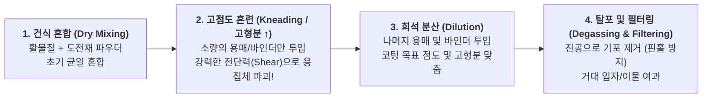

# [제2강] 배터리 전극 믹싱(Mixing) 공정 핵심 강의

> **강사 한마디:**  
> "현장에서는 흔히 **'코팅 불량의 80%는 믹싱에서 이미 결정되어 내려온다'**고 말합니다. 코터 엔지니어가 다이 립(Lip) 간격 조절하고 오븐 온도 아무리 바꿔봐야, 믹싱에서 분산이 안 된 슬러리가 내려오면 코팅 두께 편차, 줄무늬(Scratch), 핀홀, 접착력 불량을 절대 막을 수 없습니다. 믹싱의 본질과 핵심 제어 포인트를 명확히 정리해 드립니다."

---

## 1. 믹싱(Mixing) 공정의 본질과 슬러리 4대 구성 요소

믹싱 공정은 단순히 가루와 액체를 섞는 것이 아닙니다. 서로 뭉치려는 성질(응집력)이 강한 나노/마이크로 입자들을 물리적 힘(Shear Force, 전단력)과 화학적 힘으로 떼어내어 **균일하게 퍼뜨리고(분산, Dispersion)**, 코팅하기 전까지 **가라앉지 않게 유지(분산 안정성, Stability)**하는 공정입니다.

| 구성 요소 | 역할 | 양극 (Cathode - 유계) | 음극 (Anode - 수계) |
| :--- | :--- | :--- | :--- |
| **활물질 (Active Material)** | 리튬이온을 저장/방출하는 주원료 (비중 94~98%) | NCM, NCA, LFP 등 | 천연흑연, 인조흑연, 실리콘(Si) |
| **도전재 (Conductive Agent)** | 활물질 사이의 **전자 이동 통로** 형성 | 카본블랙(Super-P), **CNT(탄소나노튜브)** | 카본블랙, CNT |
| **바인더 (Binder)** | 입자 간 결합(Cohesion) 및 집전체 접착(Adhesion) | **PVDF** (고분자 바인더) | **SBR** (접착제 역할) |
| **증점제 / 분산제** | 점도 부여(침강 방지) 및 입자 분산 보조 | 수소화 니트릴 고무(HNBR 등 분산제) | **CMC** (증점 + 분산 역할) |
| **용매 (Solvent)** | 고형분을 녹이거나 분산시키는 매개체 (건조 시 증발) | **NMP** (유기용매) | **DI Water** (초순수 물) |

---

## 2. 왜 그냥 한 번에 다 넣고 안 섞을까? : 고점도 반죽(Kneading)의 비밀

밀가루로 수제비 반죽을 할 때 물을 처음부터 한강처럼 붓고 휘저으면 날가루가 뭉쳐서(더마, Agglomerate) 절대 풀리지 않습니다. 물을 조금만 넣고 뻑뻑한 상태에서 손으로 세게 치대야(반죽) 덩어리가 깨집니다. 전극 믹싱도 똑같습니다!

### ⭐ 핵심 포인트: 고점도 혼련 (Kneading)
* **원리:** 용매를 적게 넣어 반죽처럼 고형분(Solid Content)이 매우 높은 상태에서 블레이드(Blade)를 돌리면, 반죽 내부에 엄청난 **전단 응력(Shear Stress)**이 걸립니다. 이 강한 힘으로 단단하게 뭉쳐있는 **도전재(카본블랙)와 활물질 덩어리를 강제로 쪼개고(De-agglomeration)** 활물질 표면에 도전재를 고르게 코팅시킵니다.
* 최근에는 공정 시간을 줄이고 분산을 극대화하기 위해, 아예 도전재(특히 CNT)와 분산제를 미리 고도로 분산시켜 놓은 **도전재 선분산액(Pre-dispersion)**을 사용하는 추세입니다.

---

## 3. 메인 설비 구조: 플래니터리 믹서 (Planetary Mixer)

배터리 믹싱의 표준 설비는 **플래니터리 데스파 믹서(Planetary Despa Mixer)**입니다. 탱크 안에 두 종류의 날개가 들어있으며, 각각 역할이 완전히 다릅니다.

1. **플래니터리 블레이드 (Planetary Blade - 저속 자전/공전):**
   * 꾀배기 모양(Twisted) 또는 사각형 프레임 모양의 큰 날개입니다.
   * 탱크 전체를 공전하면서 동시에 자전하여, 탱크 벽면의 슬러리를 긁어내고 **전체적인 거시적 혼합(Macro-mixing)과 고점도 반죽(Kneading)**을 담당합니다.
2. **하이스피드 디졸버 (High-Speed Disperser / Homo Disper - 고속 회전):**
   * 톱니바퀴 모양의 원판 날개가 분당 수천 RPM으로 초고속 회전합니다.
   * 날개 끝단에서 강력한 와류와 충격력을 발생시켜 뭉친 입자를 박살 내는 **미시적 분산(Micro-dispersion)**을 담당합니다.

---

## 4. 양극 vs 음극 믹싱의 치명적 주의사항 (현장 실무)

### ① 양극(Cathode) 믹싱의 적: 수분(Moisture)과 겔화(Gelation)
* **원리:** 양극 활물질(특히 하이니켈 NCM)은 수분과 만나면 강한 염기성(LiOH 등, 높은 pH)을 띱니다. 이 높은 pH 환경과 수분이 **PVDF 바인더의 구조를 변형(탈불소화 반응)**시켜, 슬러리가 젤리나 두부처럼 엉겨 붙어버리는 **겔화(Gelation)** 현상을 일으킵니다.
* **결과:** 슬러리가 젤리처럼 굳으면 배관이 막히고 코팅 자체가 불가능해져 수천만 원어치 슬러리를 통째로 폐기해야 합니다. 따라서 양극 믹싱룸은 철저한 **제습(Dry Room) 관리**와 원재료 수분 관리가 생명입니다.

### ② 음극(Anode) 믹싱의 핵심: CMC와 SBR의 역할 분담 및 투입 순서
* 흑연(Graphite)은 원래 물과 친하지 않은 **소수성(Hydrophobic)**이라 물에 넣으면 둥둥 뜨고 뭉칩니다.
* **1단계 (CMC로 분산 및 점도 잡기):** 먼저 **CMC(증점제)** 수용액과 흑연을 섞어 고점도 반죽(Kneading)을 합니다. CMC가 흑연 표면에 붙어 물과 친하게 만들어주고(분산), 물의 점도를 높여 무거운 흑연이 가라앉지 않게 잡아줍니다.
* **2단계 (SBR은 맨 마지막에 살살 섞기!):** 접착제 역할을 하는 **SBR 바인더는 고무 라텍스 입자(에멀젼) 형태**입니다. 만약 SBR을 처음부터 넣고 고속 디졸버로 강하게 때리면(High Shear), 고무 입자가 깨져서 떡처럼 뭉쳐버립니다(**기계적 응집/파괴**).
  * **실무 철칙:** SBR은 CMC로 분산이 다 끝난 후 **공정 맨 마지막에 투입하여 저속으로 짧게** 섞어주어야 접착력이 살아납니다!

---

## 5. 코팅으로 넘어가기 전 3대 품질 검사 지표 (QC)

믹싱이 끝난 슬러리가 코터로 이송되기 전 반드시 통과해야 하는 3가지 성적표입니다.

1. **고형분 (Solid Content, %):**
   * 전체 슬러리 무게 중 용매를 뺀 고체(활물질+도전재+바인더)의 비율입니다. 고형분이 흔들리면 코터에서 똑같은 두께(Gap)로 발라도 건조 후 **로딩량(Loading Level, 단위면적당 무게)**이 다 틀어집니다.
2. **점도 (Viscosity, cP) 및 유변학 특성 (전단 박화, Shear Thinning):**
   * 슬러리는 가만히 있을 때는 점도가 높아서 입자가 안 가라앉고(침강 방지), 코터 다이(Slot Die)의 좁은 틈을 빠져나갈 때(고전단)는 점도가 뚝 떨어져서 스무스하게 잘 발리는 **전단 박화(Shear Thinning / 요변성, Thixotropy)** 특성을 가져야 합니다.
3. **입도 및 필터링 (Particle Size & Grind Gauge):**
   * 뭉친 거대 입자(응집체)나 금속 이물이 남아있으면 코터 다이 립에 끼어 코팅 줄무늬(Line Defect)를 만들고, 조립 후 분리막을 뚫어 **내부 단락(화재)**을 일으킵니다. 따라서 이송 중 **마그네틱 필터(철분 제거)**와 **메쉬 필터(거대 입자 제거)**를 반드시 거칩니다.
   * **탈포(Degassing):** 믹싱 막바지에 진공(Vacuum)을 걸어 슬러리 안의 미세 기포를 완벽히 빼내야 코팅 건조 후 구멍이 뚫리는 **핀홀(Pinhole)** 불량을 막을 수 있습니다.
