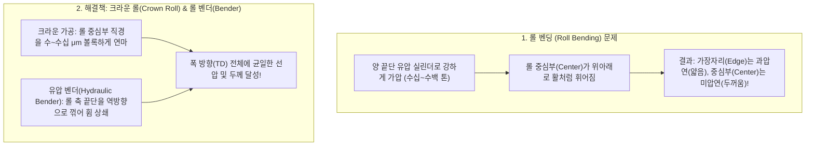

# [제3강] 롤프레스(Roll Press / Calendering) 공정 핵심 강의

> **강사 한마디:**  
> "코팅과 건조를 마친 전극은 입자들 사이에 빈 공간(기공)이 숭숭 뚫려 있는 폭신폭신한 스펀지 상태입니다. 이대로 배터리를 만들면 부피만 크고 전기가 통하지 않습니다. **롤프레스(압연) 공정은 거대한 두 개의 강철 롤 사이로 전극을 통과시켜 짓누름으로써 배터리의 '에너지 밀도'와 '출력 특성'을 최종 결정짓는 심장부**입니다."

---

## 1. 왜 롤프레스를 하는가? (압연의 목적과 딜레마)

건조 직후의 전극은 기공률(Porosity)이 50% 이상으로 매우 높습니다. 이를 목표 두께로 압축하여 **합제 밀도(Electrode Density, $g/cm^3$)**를 끌어올리는 것이 목적입니다.

### ⚖️ 엔지니어의 숙명: 합제 밀도(두께)의 Trade-off
전극을 얼마나 세게 누를 것인가(압연율)는 배터리 설계의 가장 중요한 줄다리기입니다.

| 구분 | 너무 약하게 누르면 (저밀도 / 과도한 기공) | 적정 압연 (Target Density / Porosity 20~30%) | 너무 세게 누르면 (과압연 / Over-pressing) |
| :--- | :--- | :--- | :--- |
| **에너지 밀도** | 부피당 들어가는 활물질이 적어 **용량 미달** | **최적의 부피당 에너지 밀도 구현** | 부피는 줄어드나 부작용 심각 |
| **전기적 접촉** | 입자끼리 떨어져 있어 **전자 이동 저항 증가**, 접착력 약함 | 활물질-도전재-집전체 간 **밀착력 및 전기 전도성 극대화** | **활물질 입자 깨짐 (Particle Cracking)** 발생 → 부반응 및 수명 급감 |
| **전해액 함침성** | 전해액은 잘 스며드나 불필요한 데드 볼륨 증가 | 리튬이온이 다닐 수 있는 **최적의 기공 통로(Tortuosity) 확보** | 기공이 막혀(Pore Closing) **전해액이 안 스며듦(함침 불량)** → 리튬 석출(Dendrite) 및 급속충전 불가 |

---

## 2. 롤프레스 핵심 현상 1: 스프링백 (Spring-back, 탄성 복원)

롤프레스 엔지니어가 가장 먼저 이해해야 할 물리 현상입니다.
* **현상:** 만약 목표 전극 두께가 $100\mu m$라고 해서 두 프레스 롤 사이의 간격(Roll Gap)을 $100\mu m$로 맞추고 누르면 어떻게 될까요? 롤을 빠져나온 직후 전극 두께를 재보면 $105 \sim 115\mu m$로 다시 부풀어 올라와 있습니다!
* **원인:** 활물질 입자와 고분자 바인더(특히 고무 성질인 음극 SBR)가 가진 **탄성(Elasticity)** 때문에, 압축 하중이 사라지는 순간 원래 상태로 돌아가려는 **탄성 복원(Spring-back)**이 일어납니다. (시간이 지나며 서서히 더 부푸는 현상까지 포함).
* **실무 대책:** 
  1. 목표 두께보다 롤 갭을 더 좁게 설정하고 선압(Line Pressure)으로 제어합니다.
  2. 최근에는 **승온 프레스(Hot/Warm Roll Press, 롤 내부에 열매체유나 유도코일로 $60 \sim 120^\circ C$ 가열)**를 적용합니다. 열을 가하면 바인더가 연화(부드러워짐)되어 소성 변형이 잘 일어나므로 **낮은 압력으로도 쉽게 압축되고, 스프링백과 입자 깨짐이 획기적으로 줄어듭니다.**

---

## 3. 롤프레스 핵심 현상 2: 롤 벤딩(Roll Bending)과 크라운/벤더 제어

전극 광폭화(폭 1,000mm~1,500mm 이상)가 진행되면서 발생하는 가장 골치 아픈 기계적 문제입니다.

* **문제점:** 수백 톤의 힘으로 양 끝 축을 누르면, 아무리 단단한 합금강 롤이라도 중심부가 미세하게 벌어집니다(수 $\mu m \sim$ 수십 $\mu m$). 이대로 누르면 전극 가운데는 두껍고 양 끝단만 얇아지는 치명적인 **폭 방향(TD) 두께 편차**가 발생합니다.
* **해결 기술:**
  1. **크라운 롤 (Crown Roll):** 롤을 제작할 때 아예 중심부를 배불뚝이처럼 미세하게 볼록한 곡선으로 연마해 놓아, 휘어졌을 때 딱 평평해지도록 맞추는 방식입니다. (단점: 모델이나 압력이 바뀌면 대응이 어려움).
  2. **롤 벤딩 시스템 (Roll Bender / Crossing):** 유압 실린더로 롤 축에 역방향 모멘트를 가해 휘어짐을 실시간으로 펴주거나, 상/하 롤을 아주 미세하게 비틀어(Crossing) 폭 방향 압력 분포를 정밀 제어합니다.

---

## 4. 롤프레스 치명적 불량: 캠버(Camber)와 웨이브(Wave)

롤프레스는 딱딱한 코팅부(합제층)와 얇은 무지부(코팅 안 된 포일 부분, Foil)가 붙어있는 기재를 누르기 때문에 **연신율(늘어나는 정도) 차이**로 인한 외관 불량이 극심합니다.

### ① 무지부 웨이브 (Edge Wave / Buckling) 및 파단
* **원인:** 롤이 두꺼운 코팅부만 짓누르기 때문에 **코팅부는 진행 방향(MD)으로 길게 늘어납니다(연신, Elongation).** 반면 코팅이 안 된 옆쪽 **무지부(Al/Cu Foil)는 롤에 안 눌리므로 늘어나지 않습니다.**
* **결과:** 늘어난 코팅부와 안 늘어난 무지부 경계에서 엄청난 인장/압축 스트레스 차이가 발생합니다. 이로 인해 코팅부나 무지부가 치마처럼 우글쭈글하게 우는 **웨이브(Wave) 불량**이 생기고, 심하면 무지부가 버티지 못하고 찢어져 **단선(Web Break)**됩니다.
* **해결책 (무지부 연신기 / Induction Heater / 텐션 제어):**
  * 프레스 직후 또는 직전에 무지부에만 열을 가하거나(고주파 유도 가열 등), 특수 롤로 무지부를 강제로 늘려주어 코팅부와의 길이 차이를 맞춰주는 **연신 밸런싱 장치**를 사용합니다.

### ② 캠버 (Camber - 사행/휘어짐)
* **원인:** 롤의 좌측(작업자측, WS)과 우측(구동측, DS)의 압력(Gap)이 미세하게 다르거나, 코팅 시 좌우 두께(Loading) 편차가 넘어온 경우 발생합니다.
* **결과:** 더 많이 눌린 쪽이 더 길게 늘어나면서, 압연된 전극이 똑바로 안 가고 바나나처럼 한쪽으로 휘어지는 현상입니다. 캠버가 발생하면 다음 공정인 슬리팅에서 치수가 다 틀어집니다.
* **대책:** 프레스 후단에 설치된 **실시간 두께 측정기(Beta/X-ray Gauge)** 데이터를 피드백 받아 좌/우 유압 실린더 압력을 독립적으로 자동 보정(AGC, Automatic Gauge Control)해야 합니다.

---

## 5. 롤 표면 관리 (Roll Maintenance)

* 프레스 롤 표면은 거울처럼 매끄러운 **초정밀 경면(조도 $Ra$ 관리)** 상태여야 하며, 극도의 표면 경도(일명 쇼어 경도 $HS$ 90 이상급)를 가집니다.
* 만약 전극에서 떨어진 활물질 가루가 롤 표면에 달라붙으면, 롤이 한 바퀴 돌 때마다 전극에 똑같은 간격(롤 원주 길이 주기)으로 구멍이나 자국을 찍어내는 **주기성 찍힘 불량(Dent)**을 만듭니다.
* 따라서 롤 표면을 실시간으로 닦아내는 **독터 블레이드(Doctor Blade) + 클리닝 부직포/브러시 + 집진 석션(Suction)** 관리가 현장 수율의 핵심입니다.
