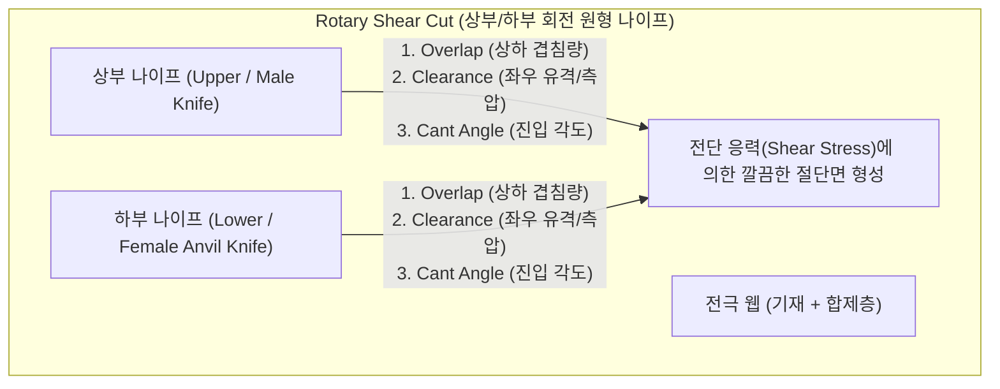
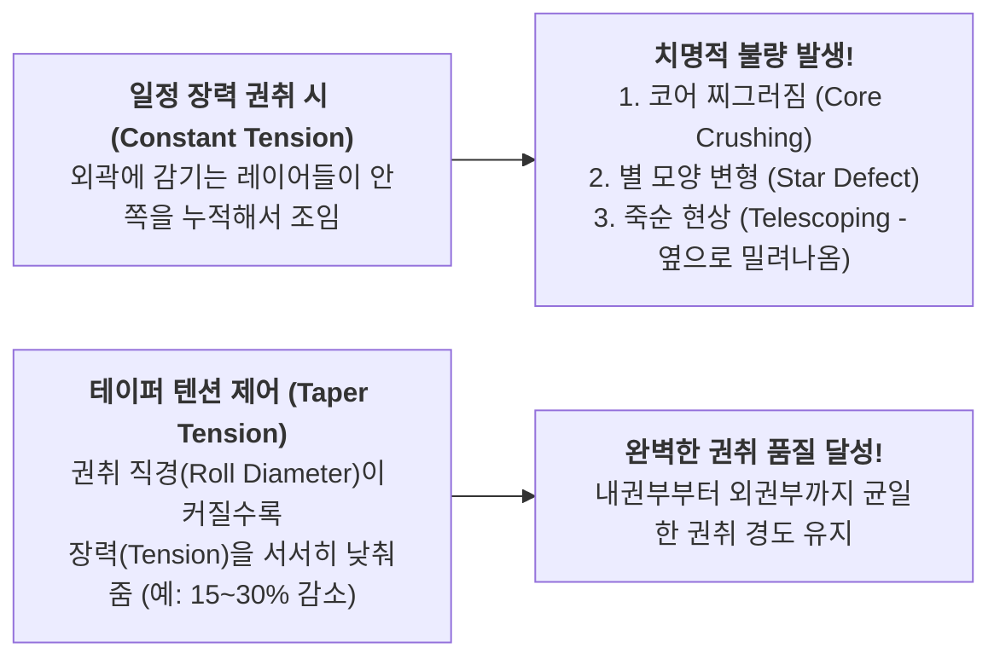

# [제4강] 슬리팅(Slitting) 공정 핵심 강의

> **강사 한마디:**  
> "슬리팅은 전극 공정(전공정)의 마지막 관문입니다. 광폭으로 코팅되고 압연된 거대한 점보 롤(Jumbo Roll)을 배터리 셀 규격에 맞게 국수 가락처럼 여러 갈래(Lane)로 정밀하게 자르는 공정입니다. 단순히 자르는 것처럼 보이지만, **절단면에서 발생하는 단 하나의 미세한 금속 가시(Burr)나 금속 분진이 배터리 내부 단락(화재/폭발)의 직접적인 방아쇠**가 되기 때문에 품질 기준이 가장 가혹한 공정입니다."

---

## 1. 슬리팅의 핵심 원리: 전단 절단 (Shear Cut)

배터리 전극 슬리팅에서는 면도날로 베는 방식(Razor Cut)이 아니라, 가위로 종이를 자르는 것과 동일한 원리인 **회전식 전단 절단(Rotary Shear Cut)** 방식을 표준으로 사용합니다.

### 🔪 나이프 세팅의 3대 핵심 파라미터
가위질할 때 두 날이 서로 살짝 겹치면서 옆으로 밀착되어야 종이가 깔끔하게 잘리는 것처럼, 상도(Upper Knife)와 하도(Lower Knife)의 기구적 세팅이 절단 품질의 99%를 결정합니다.

1. **오버랩 (Overlap, 상하 겹침량):**
   * 상부 칼날이 하부 칼날 아래로 얼마나 깊게 내려와 겹치는가입니다 (보통 수백 $\mu m$ 수준).
   * **너무 깊으면:** 칼날 마모가 빠르고 전극 가장자리가 꺾이는 컬링(Curling) 및 크랙 발생.
   * **너무 얕으면:** 전극이 완전히 안 잘리고 뜯겨 나가며 거대한 **버(Burr)** 발생.
2. **클리어런스 / 측압 (Clearance / Side Force):**
   * 상부 칼날과 하부 칼날 측면 사이의 밀착 힘(또는 미세 간격)입니다. 스프링이나 공압으로 일정한 측압을 유지해 주어야 가위 날이 벌어지지 않고 깔끔한 전단(Shearing)이 일어납니다.
3. **캔트 앵글 (Cant Angle / Toe-in Angle):**
   * 상부 칼날을 진행 방향에 대해 아주 미세한 각도($0.1^\circ \sim 0.5^\circ$ 내외)로 비스듬히 기울여 세팅하여, 칼날 전체가 아닌 **절단점(Point Contact)**에서만 하부 칼날과 만나도록 하는 정밀 세팅입니다.

---

## 2. 슬리팅 공정의 최대 적: 버(Burr)와 파우더(이물)

왜 슬리팅 엔지니어들은 현미경을 들고 절단면만 하루 종일 들여다볼까요?

### ⚠️ 치명적 결함 1: 금속 버 (Metal Burr)
* **정의:** 알루미늄(Al)이나 구리(Cu) 포일이 칼날에 잘릴 때 깔끔하게 끊어지지 않고, 금속이 칼날을 따라 길게 늘어지면서 절단면 아래나 위로 뾰족한 **금속 가시(돌기)**처럼 튀어나오는 현상입니다.
* **왜 위험한가?**
  * 배터리 조립 시 양극과 음극 사이에 들어가는 **분리막(Separator)의 두께는 고작 $10 \sim 15\mu m$ 안팎**입니다.
  * 만약 슬리팅 절단면에서 $15\mu m$가 넘는 뾰족한 금속 버(Burr)가 발생하면, 와인딩(권취)이나 스태킹(적층) 후 압력을 받을 때 **분리막을 찔러 관통**합니다. 이는 곧바로 **내부 단락(Internal Short Circuit) → 전압 강하(Low Voltage 불량) → 열폭주(화재)**로 이어집니다!
* **현장 관리 기준:** 보통 버(Burr)의 높이를 **$5 \sim 10\mu m$ 이하**로 엄격히 규제하며, 칼날의 주행 거리(예: 100km~300km)마다 칼날을 교체하거나 연마(Polishing)합니다.

### ⚠️ 치명적 결함 2: 절단부 크랙(Edge Crack) 및 분진(Dust)
* 칼날이 딱딱하게 압연된 코팅층(특히 두껍고 취성이 강한 양극)을 누를 때, 절단면 주변의 활물질이 깨져 나가면서 **코팅 탈락(Chipping)**과 **미세 금속/활물질 분진**이 쏟아집니다.
* **대책:** 칼날 직후단에 **초음파 진동 브러시 + 진공 석션(Suction) 클리너**를 설치하여 절단 순간 발생하는 분진을 즉시 빨아들이고, 비전 검사기(Vision Inspector)로 폭 치수와 절단면 불량을 전수 검사합니다.

---

## 3. 슬리팅의 숨은 고난도 기술: 권취(Winding)와 텐션 프로파일

여러 갈래로 잘린 전극(Slit Roll / Pancake)을 각각의 코어(Core)에 예쁘게 감아주는 **리와인딩(Rewinding)** 과정도 절단만큼이나 중요합니다.

### ① 왜 프리크션 샤프트(Friction Shaft / 차동축)를 쓰는가?
* 광폭 롤 하나를 4갈래~8갈래로 자르면, 롤프레스를 거치며 생긴 미세한 폭 방향 두께 편차 때문에 **각 갈래(Lane)마다 감기는 롤의 외경(직경)이 미세하게 달라집니다.**
* 만약 일반 통축으로 똑같은 속도로 감으면, 두꺼운 쪽은 팽팽해져서 터지고 얇은 쪽은 헐거워져서 주름이 집니다.
* 따라서 각 코어마다 개별적으로 미끄러지며(Slip) **모든 레인에 동일한 장력(Tension)을 독립적으로 부여하는 프리크션 샤프트(Friction Ring Shaft)** 기술이 필수입니다.

### ② 테이퍼 텐션 제어 (Taper Tension Control) ⭐핵심!
전극을 코어에 처음 감기 시작할 때(내권부)부터 다 감았을 때(외권부, 직경 증가)까지 똑같은 장력(Constant Tension)으로 감으면 큰일이 납니다!

* **테이퍼 텐션(Taper Tension)의 원리:** 롤이 감기면서 부피(직경)가 커질수록 장력을 설정된 비율(Taper %)만큼 **점진적으로 줄여주는 제어 방식**입니다.
  * **초반(코어 부근):** 상대적으로 높은 장력으로 단단하게 감아 중심이 옆으로 빠지는 **죽순 현상(Telescoping)**을 방지합니다.
  * **후반(외권부):** 장력을 낮춰주어, 바깥쪽 전극이 안쪽 전극을 과도하게 조여서 내부 전극이 꺾이거나 별 모양으로 찌그러지는 **스타 디펙트(Star Defect)** 및 **블로킹(Blocking)** 현상을 방지합니다.

---

## 🏆 [전극 4대 공정 한눈에 요약 정리]

| 공정 | 핵심 미션 | 가장 무서운 불량 | 엔지니어의 핵심 무기 (제어 변수) |
| :--- | :--- | :--- | :--- |
| **1. 믹싱** | 응집체 파괴 및 균일 분산 | 침강, 겔화(양극), 거대 응집체 | 고점도 혼련(Kneading), 투입 순서(SBR 후투입), 고형분/점도 |
| **2. 코팅/오븐** | 균일 도포 및 미세구조 고정 | **바인더 마이그레이션**, 크랙, 핀홀 | **FIR(초기 승온)** + **대류 열풍(항률 구간 제어)**, 상하 풍압 밸런스 |
| **3. 롤프레스** | 목표 합제 밀도 달성 및 평탄화 | 입자 깨짐, **웨이브(연신차)**, 캠버 | 선압/롤갭, **승온 프레스(스프링백 억제)**, 크라운/벤더 제어 |
| **4. 슬리팅** | 무결점 절단 및 고품질 권취 | **금속 버(Burr → 쇼트/화재)**, 죽순 현상 | 나이프 **오버랩/측압**, 프리크션 샤프트, **테이퍼 텐션** |
